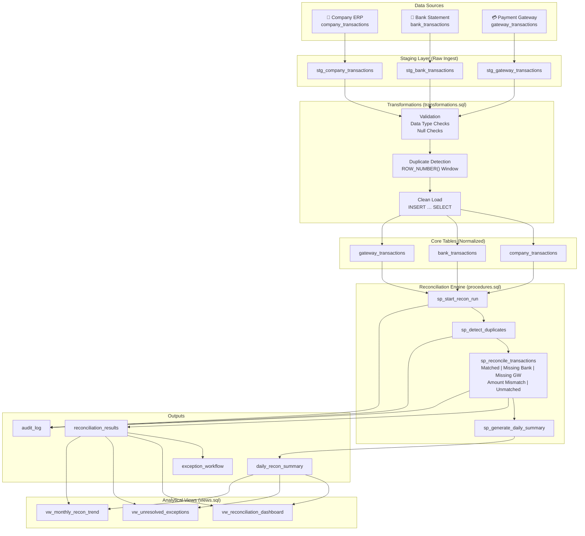
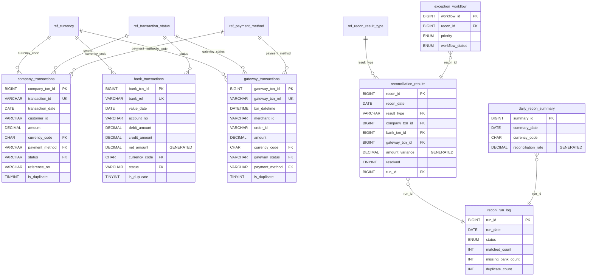
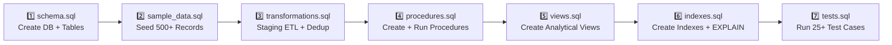

# Architecture — Enterprise Financial Data Reconciliation & Exception Management Engine

## Business Problem Statement

> **Scenario:** A mid-sized B2B SaaS company processes thousands of financial transactions daily through three independent systems: its own ERP/accounting system, its banking partner, and a third-party payment gateway. Due to timing differences, bank fees, system outages, and occasional double-submissions, these three systems regularly disagree.
>
> The finance team currently reconciles these records **manually in Excel**, spending ~40 hours per month identifying discrepancies. Even then, mismatches worth thousands of dollars go undetected until the monthly close. The company needs a **fully automated, auditable reconciliation engine** that runs nightly, classifies every exception, and routes it to the right team for resolution.

---

## System Overview



---

## Database Schema (ERD)



---

## Reconciliation Algorithm

The core matching logic runs in this order inside `sp_reconcile_transactions`:

| Step | Classification | Matching Logic |
|------|---------------|----------------|
| 1 | **MATCHED** | `company.reference_no` found in `bank.description` AND = `gateway.order_id`, amounts within \$0.01 tolerance |
| 2 | **AMOUNT_MISMATCH** | Reference matches but `|company.amount − bank.net_amount| > 0.01` or gateway differs |
| 3 | **MISSING_BANK** | Company record exists but no bank row references its `reference_no` |
| 4 | **MISSING_GATEWAY** | Company record exists but no gateway row has `order_id = reference_no` |
| 5 | **UNMATCHED_BANK** | Bank row cannot be linked to any company record |
| 6 | **UNMATCHED_GATEWAY** | Gateway row cannot be linked to any company record |
| 0 (pre-run) | **DUPLICATE_*** | `ROW_NUMBER() OVER (PARTITION BY reference_no, amount)` > 1 |

> [!NOTE]
> Duplicate detection runs **before** matching. Flagged duplicates are excluded from all subsequent matching steps, ensuring the same transaction is never double-counted.

---

## Execution Order



---

## Key SQL Techniques Used

| Technique | File | Purpose |
|-----------|------|---------|
| `ROW_NUMBER() OVER (PARTITION BY ...)` | transformations.sql, procedures.sql | Duplicate detection |
| `LAG() / LEAD() / FIRST_VALUE()` | procedures.sql, views.sql | Sequential analysis and window aggregation |
| `SUM(...) OVER (ORDER BY ... ROWS UNBOUNDED PRECEDING)` | views.sql | Running totals |
| `RANK() OVER (ORDER BY ...)` | views.sql | Customer variance ranking |
| Common Table Expressions (CTEs) | procedures.sql, views.sql | Readable multi-step reconciliation |
| `LEFT JOIN` with NOT EXISTS | procedures.sql | Identifying missing counterparts |
| `INSERT ... ON DUPLICATE KEY UPDATE` | procedures.sql | Idempotent daily summary upserts |
| `GENERATED ALWAYS AS ... STORED` | schema.sql | `net_amount`, `amount_variance`, `reconciliation_rate` |
| `FULLTEXT INDEX` + `MATCH() AGAINST()` | indexes.sql | Efficient description search |
| `EXPLAIN FORMAT=TRADITIONAL` | indexes.sql | Query plan analysis |
| `SIGNAL SQLSTATE '45000'` | procedures.sql | Custom error raising |
| `DECLARE EXIT HANDLER FOR SQLEXCEPTION` | procedures.sql | Transaction error handling |

---

## Project File Map

```
fin-reconciliation-engine/
├── database/
│   ├── schema.sql          # 1st — All table definitions, FKs, generated columns
│   ├── sample_data.sql     # 2nd — 500+ realistic seed records
│   ├── transformations.sql # 3rd — Staging → Core ETL with validation
│   ├── procedures.sql      # 4th — 6 stored procedures + run execution
│   ├── views.sql           # 5th — 8 analytical views
│   ├── indexes.sql         # 6th — Covering indexes + EXPLAIN plans
│   └── tests.sql           # 7th — 25+ test assertions
├── documentation/
│   └── architecture.md     # This file
└── README.md               # Setup guide + project overview
```

---

## Performance Considerations

| Query Pattern | Index Strategy | Expected Type |
|--------------|----------------|---------------|
| `WHERE is_duplicate=0 AND currency_code=?` | `idx_comp_ref_curr_dup` | `ref` |
| `WHERE order_id=? AND currency_code=?` | `idx_gw_order_curr_dup` | `ref` |
| `WHERE resolved=0 ORDER BY variance` | `idx_recon_unresolved` | `ref` / `range` |
| `MATCH(description) AGAINST (?)` | `ft_bank_description` | `fulltext` |
| `GROUP BY DATE_FORMAT(summary_date,...)` | `idx_drs_date_curr` | `range` |

> [!TIP]
> Run `ANALYZE TABLE` after each bulk data load to refresh optimizer statistics and ensure the query planner picks the correct indexes.

> [!WARNING]
> The `bank.description LIKE '%reference_no%'` join pattern cannot use a standard B-Tree prefix index. For production volumes > 1M rows, migrate to a **FULLTEXT** search or extract the reference number into a dedicated indexed column during the bank statement ingestion step.
